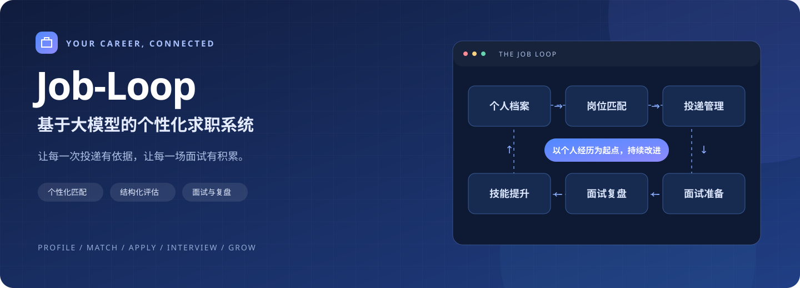
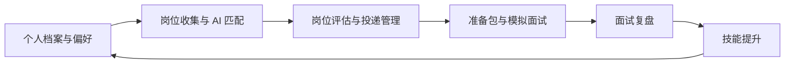

<div align="center">



# Job-Loop：基于大模型的个性化求职系统

**从一份个人档案出发，连接岗位发现、投递决策与面试成长。**

Vue 3 · Element Plus · FastAPI · 大模型辅助 · 本地数据存储

[项目简介](#项目简介) · [功能展示](#功能展示) · [快速开始](#快速开始) · [技术架构](#技术架构) · [后续规划](#后续规划)

</div>

---

## 项目简介

求职过程中，个人经历散落在简历里，岗位信息分布在招聘页面中，投递进度靠表格记录，面试反馈又经常停留在聊天记录和笔记里。

**Job-Loop 希望把这些信息连接起来。** 项目围绕个人档案和求职偏好，利用大模型辅助推荐目标岗位、评估匹配程度、生成面试准备包，并将模拟面试、正式面试复盘与技能提升串联为一套持续改进的工作流程。

你可以在同一个工作台里回答这些问题：

- **该关注什么岗位？** 根据个人经历、意向方向、城市与企业类别获取推荐。
- **这个岗位适合我吗？** 查看匹配评分、能力亮点、差距与求职底线检查结果。
- **我的申请进行到哪里了？** 集中维护申请、投递、面试和结果状态。
- **面试应该准备什么？** 针对具体岗位生成分层题库，进行模拟问答和逐题分析。
- **下一步应该补什么？** 结合岗位要求与面试反馈，制定学习路线和行动计划。

> 适用于希望系统整理求职信息的应届生、实习生与社招求职者。当前版本主要面向个人本地使用。

## 一条完整的求职流程



## 功能展示

> 以下为当前前端界面的实际截图，使用虚构公司、岗位和面试内容展示功能。截图中的薪资、评分与结果均为示例，不代表真实招聘信息或模型效果评测。

### 01 · 岗位收集：把信息变成可管理的候选岗位

支持手动粘贴 JD 并预览解析结果，也可以结合个人档案，通过岗位方向、城市、求职类型和行业类别进行 AI 智能匹配。

- **分档推荐**：按冲刺、匹配、稳妥展示目标公司与岗位建议。
- **展开查看**：查看推荐理由、岗位介绍、任职要求和渠道提示。
- **加入候选池**：将感兴趣的岗位纳入统一管理，继续评估和创建申请。
- **维护记录**：支持手动添加、单条删除与批量删除。


### 02 · 投递中心：用评估依据安排求职优先级

将候选岗位、匹配结果和申请进度放在同一页面，减少反复切换文档与表格的成本。

- **多维评估**：围绕技能、经历、学历和发展方向展示匹配结果。
- **底线检查**：结合个人设置检查外包、加班等条件；AI 不可用时的规则估算会标明来源。
- **可停止任务**：批量评估支持停止，已经完成的评分会保留。
- **进度跟踪**：创建申请、手动登记投递、更新状态和备注。
- **精确删除**：支持候选岗位与投递记录的单条、批量删除，并明确关联数据的保留范围。


### 03 · 面试准备：围绕你的经历和目标岗位练习

准备包结合个人档案、岗位描述和面试素材生成，让练习更贴近实际申请。

- **四层题库**：基础介绍、项目深挖、压力质疑、岗位匹配。
- **答题提示**：提供考察意图、回答要点与追问方向。
- **模拟面试**：支持多轮问答、逐题分析与改进建议。
- **历史记录**：保存完整对话与报告，支持展开回看和按场次删除。
- **可停止生成**：准备包生成支持停止，已有准备包不会被取消任务的迟到结果覆盖。


### 04 · 更多能力：从整理经历到持续提升

| 模块 | 能力 | 使用价值 |
| :--- | :--- | :--- |
| 🧭 首页概览 | 求职统计、流程概览与下一步提示 | 快速了解当前进展 |
| 👤 个人档案 | 基本信息、教育经历、项目、论文荣誉、求职偏好与 STAR 素材 | 为推荐和面试准备提供个人背景 |
| 📄 简历导入 | 提取 PDF / Word 简历内容，辅助填写档案 | 减少重复录入 |
| 📝 面试复盘 | 整理问答、分析反馈、归纳卡壳点 | 把一次面试转化为可复用的经验 |
| 📚 技能提升 | 差距热图、分阶段学习路线、行动计划 | 将反馈落到下一步学习任务 |
| ⚙️ 模型配置 | 配置接口地址、模型名称和 API Key | 接入兼容项目调用方式的模型服务 |

## 快速开始

建议使用 **Python 3.10+、Node.js 22+**。AI 功能需要自行配置可用的模型服务。

### 1. 获取代码并安装后端依赖

```bash
git clone https://github.com/wenci233-bot/job-loop.git
cd job-loop

python -m venv .venv
```

激活虚拟环境，按你的系统选择一条：

```bash
# Linux / macOS
source .venv/bin/activate

# Windows PowerShell
.venv\Scripts\Activate.ps1
```

```bash
python -m pip install -r requirements.txt
# 简历上传接口需要此依赖
python -m pip install python-multipart
```

### 2. 构建前端

```bash
cd web
npm ci
npm run build
cd ..
```

### 3. 配置模型服务

将根目录的 `.env.example` 复制为 `.env`，填写自己的配置：

```dotenv
AI_BASE_URL=https://your-provider.example/v1
AI_API_KEY=your_api_key
AI_MODEL=your_model_name
```

以上地址和参数是占位示例，请替换为服务商提供的有效配置。`AI_BASE_URL` 应为接口基础地址，不包含 `/chat/completions`。也可以启动后在系统设置中配置。

### 4. 启动应用

```bash
python run.py --port 18556
```

浏览器访问 **http://127.0.0.1:18556**。

在远程服务器上运行时，可以使用 VS Code 转发 `18556` 端口，并关闭服务器自动打开浏览器的行为：

```bash
python run.py --port 18556 --no-open
```

<details>
<summary><b>Windows 桌面打包</b></summary>

项目提供 `launcher.py` 和 `JobLoop.spec`。在 Windows 环境中安装依赖、完成前端构建后执行：

```bash
python -m pip install pyinstaller
pyinstaller JobLoop.spec
```

生成目录通常为 `dist/JobLoop/`，运行其中的 `JobLoop.exe`。分发时需要包含整个目录，不要仅复制 EXE。当前打包入口使用端口 `18555`，与上面的源码运行示例不同。

程序资产放在打包目录中的 `_internal/`，用户数据存放在 EXE 所在目录的对应数据文件夹。更新程序时应保留自己的数据目录与 `.env`。

</details>

## 技术架构

| 层次 | 技术与实现 |
| :--- | :--- |
| 前端 | Vue 3、Vue Router、Element Plus、Vite |
| 后端 | Python、FastAPI、Pydantic |
| 模型调用 | OpenAI 兼容的 Chat Completions 接口、任务专用提示词 |
| 后台任务 | Python 后台线程、进度轮询、批量评估与准备包取消机制 |
| 当前存储 | JSON、CSV、Markdown 与本地附件文件 |
| 桌面分发 | PyInstaller |

```text
job-loop/
├── server/
│   ├── api/           # HTTP 接口
│   ├── services/      # 匹配、评估、面试与复盘逻辑
│   └── storage/       # 本地数据读写
├── web/src/           # 页面、组件与任务状态管理
├── prompts/           # 各类 AI 任务的提示词模板
├── tests/             # 后端回归测试
├── tools/             # 岗位信息处理等辅助脚本
├── assets/readme/     # 仓库展示图片
├── .env.example       # 模型配置示例
├── run.py             # 源码启动入口
├── launcher.py        # 桌面打包入口
└── JobLoop.spec       # PyInstaller 配置
```

`prompts/` 是运行所需的项目资源，需随源码或程序一起分发。

## 数据与使用说明

- **业务数据保存在本地文件中**；运行时会创建个人档案、岗位、投递、面试记录等目录。
- **本地存储不等于 AI 请求离线运行**。使用 AI 功能时，相关档案、JD 或对话内容会按任务需要发送至你配置的模型服务。
- `.gitignore` 已排除 `.env`、个人业务数据、`docs/`、依赖目录与构建产物。新克隆的项目不包含个人数据，需要自行构建前端。
- AI 推荐、薪资描述、评分和面试反馈用于辅助判断，请结合实际招聘信息与个人情况使用。
- 创建申请用于记录求职进度，实际提交简历仍需在招聘官网或对应渠道完成。

## 验证与开发

```bash
# 后端回归测试
python -m unittest discover -s tests -v

# 前端任务停止机制测试
cd web
node --test tests/task-stop.test.mjs

# 前端开发服务
npm run dev
```

前端开发代理默认指向本机 `18556` 端口，开发时需同时启动后端。

## 后续规划

以下是计划方向，**尚未作为当前功能提供**：

- [ ] 将核心业务数据迁移至 SQLite，并建立数据库结构升级机制。
- [ ] 完善数据迁移、备份与恢复工具。
- [ ] 持续改善岗位关联、检索和求职过程统计。

---

<div align="center">

**从找到机会，到准备好自己。**

Job-Loop · 让求职的每一步，都能为下一步积累。

</div>
