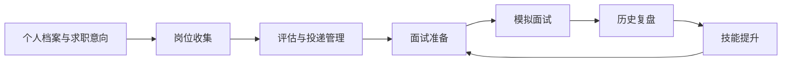
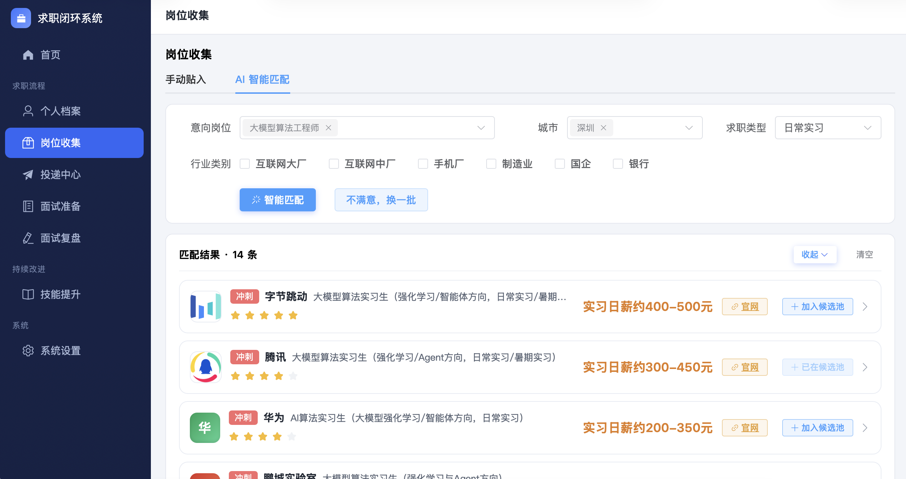
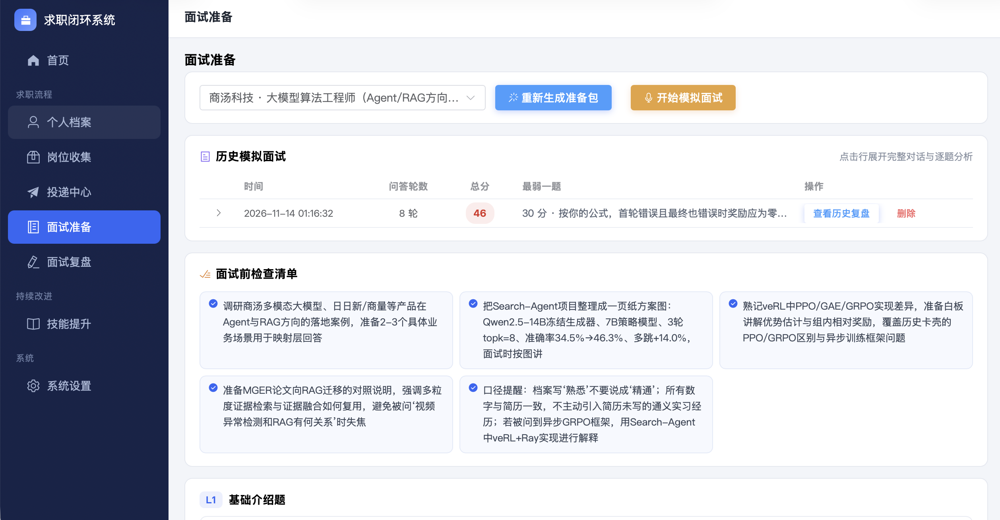
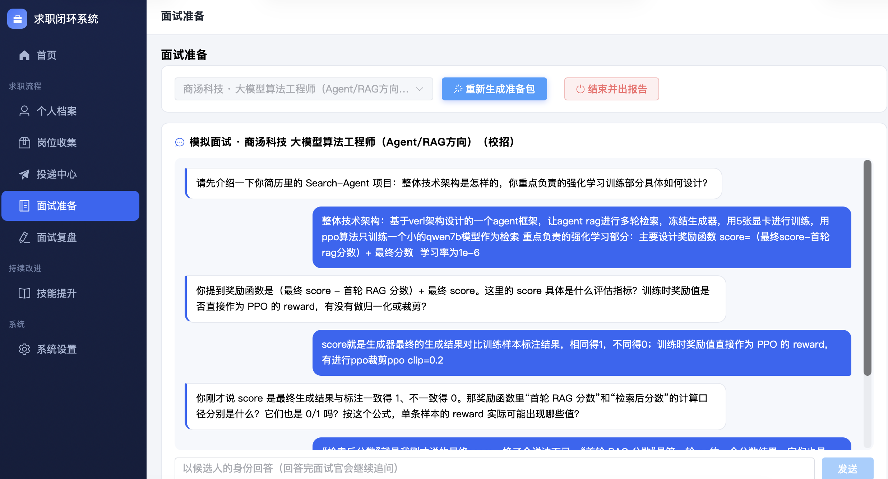
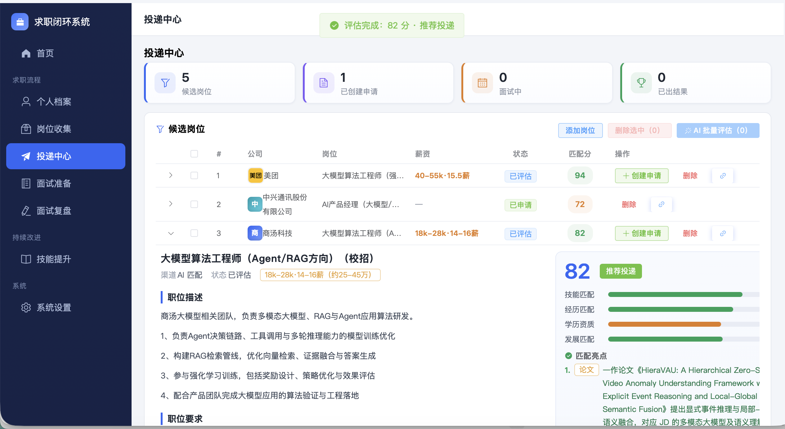

# Job-Loop · 基于大模型的个性化求职系统

**从找到意向岗位，到准备面试，再把每次反馈变成下一步行动。**

岗位匹配 · 投递管理 · 面试准备 · 模拟面试 · 复盘提升

Vue 3 · Element Plus · FastAPI · 大模型辅助

---

## 项目简介

Job-Loop 是一个围绕个人档案与求职意向构建的求职工作台，将岗位收集、匹配评估、申请跟踪、面试练习和历史复盘连接起来。

你可以先明确想做的岗位或行业，再让 AI 结合已有经历分析机会与差距；也可以直接粘贴职位描述，整理成候选岗位，继续评估和准备面试。每次模拟面试保存后，对话与报告会自动汇入历史复盘，为后续练习和技能提升提供依据。

## 功能展示

### 01 · 岗位收集：从求职意向出发寻找机会

支持手动贴入 JD，也支持 AI 智能匹配。意向可以是具体岗位、行业，或一段自然语言描述，例如“半导体，只考虑芯片验证”。推荐优先遵循求职意向，再结合个人档案判断能力差距和投递档位。

- **多条件匹配**：结合意向方向、城市、求职类型和行业类别生成推荐。
- **三档推荐**：按冲刺、匹配、稳妥展示岗位，并说明推荐理由。
- **岗位详情**：查看职责、能力要求、薪资描述和建议渠道。
- **候选池管理**：收藏感兴趣的机会；不满意时换一批，并排除历史推荐公司。

### 02 · 面试准备：让题库贴近岗位和个人经历

所有候选岗位与已创建申请都可以用于面试准备，无需先登记投递。AI 结合个人档案、岗位描述、面试素材和历史卡壳点，生成针对性的准备包。

- **面试前检查清单**：梳理公司业务、项目表述、技术细节和需要补充的证据。
- **四层题库**：覆盖基础介绍、项目深挖、压力质疑和岗位匹配。
- **回答参考**：提供考察意图、回答要点和可能的追问。
- **历史回看**：按岗位保存准备包与模拟面试记录，可查看完整对话和逐题分析。

### 03 · 模拟面试：围绕你的回答持续追问

选择目标岗位后，即可开展多轮模拟面试。面试官结合岗位要求和当前回答继续追问，帮助发现项目讲解中的模糊点、技术细节缺口，以及指标口径不清等问题。

- **多轮问答**：围绕经历、职责和回答内容展开追问。
- **逐题反馈**：结束后生成报告，给出分数、问题分析与改进建议。
- **完整留档**：保存问答过程、总体评价和薄弱题目，方便反复练习。
- **自动进入复盘**：成功保存的模拟面试会自动加入历史复盘，重复访问不会重复导入。

### 04 · 投递中心：把岗位评估和申请进度放在一起

集中管理候选岗位与申请记录。既可以对一个岗位单独评估，也可以勾选多个岗位批量评估；已评估岗位支持重新评估。

- **多维匹配评分**：从技能、经历、学历资质和发展方向分析匹配程度。
- **亮点与差距**：展开查看岗位描述、匹配依据、能力缺口和投递建议。
- **求职底线检查**：结合个人设置识别外包、加班等不符合要求的条件。
- **申请进度管理**：创建申请并跟踪投递、面试及结果状态。
- **任务进度可见**：批量评估支持查看进度和停止，已完成的评分会保留。

## 从面试反馈到持续提升

历史复盘统一汇总手动记录与模拟面试报告。可以回看原始问答、查看逐题评价，归纳反复出现的薄弱点，再据此安排下一轮准备。

| 模块 | 作用 |
| :--- | :--- |
| 个人档案 | 整理教育、工作、项目、技能与求职偏好，为匹配和面试提供背景 |
| 面试素材 | 积累可复用的项目案例与 STAR 表述 |
| 历史复盘 | 汇总正式面试记录与模拟问答，保留分析和改进建议 |
| 技能提升 | 结合目标岗位要求和面试卡壳点，生成学习路线与行动计划 |
| 首页概览 | 集中查看候选岗位、申请和面试等求职进展 |

## 实现特点

- **前后端分离**：Vue 3 与 Element Plus 构建交互界面，FastAPI 提供业务接口。
- **任务专用提示词**：匹配、评估、面试、复盘和学习计划分别使用独立模板。
- **后台任务管理**：岗位匹配、批量评估和准备包生成支持进度反馈与停止操作。
- **本地记录留存**：个人档案、岗位资料和面试历史通过本地文件保存，AI 功能调用配置的模型服务。

---

**让每次投递更有依据，让每场面试都有积累。**

